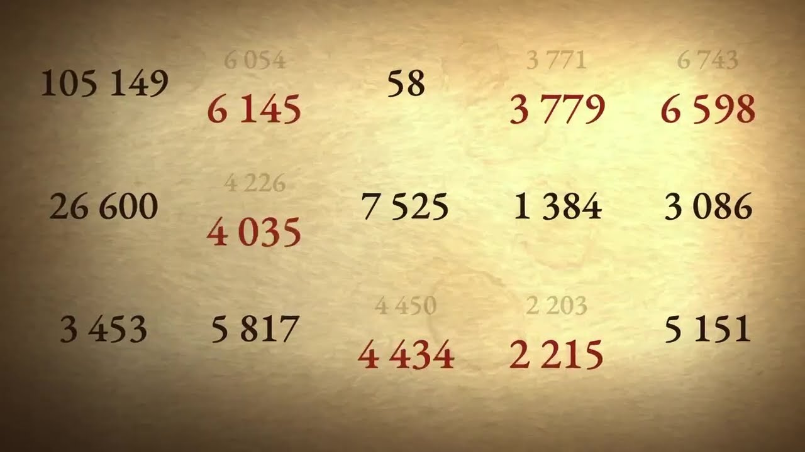

<h1 align="center">Palimpsest</h1>

<p align="center">Read and question Wikipedia as it stood on a date, and trace how it changed.</p>

<p align="center">
  <a href="https://youtu.be/7_V-USwvJDQ">
    
  </a>
</p>

A number changes. A paragraph disappears and comes back. A claim survives through several rewrites. Wikipedia keeps those edits, but following a question across them means piecing the history together yourself.

Palimpsest makes that history searchable. It holds **862,076 versions of 19,742 Finnish articles about the history of Finland** in MariaDB, with each paragraph’s wording tied to the period when it stood.

- Ask *“How many Finnish soldiers died in the Winter War?”* of 2007 and of the latest archived version, side by side.
- Trace a sentence—or a claim extracted from an image—to its earlier wordings and first appearance found in the dataset.
- Read an article on a date, compare revisions, or ask who held an office according to Wikipedia at another point in time.

## How it works

1. **MariaDB keeps time.** System-versioned rows preserve wording lifetimes using Wikipedia’s edit timestamps.
2. **Search finds the evidence.** Full-text and vector retrieval are joined to those lifetimes so answers cite passages that existed on the selected date. Each view exposes its SQL.
3. **Gemini explains it.** Answers carry passage citations and numeric checks. The historian agent calls database tools, while paragraph stories explain how a wording evolved.

An MCP endpoint exposes the same research tools to other assistants. The Atlas and [labs](labs) explore what the edits reveal about reverts, surviving paragraphs and disagreements between language editions.

Built at Junction 2026 for MariaDB’s **Wikipedia Through Time** challenge, combining its vector-search and system-versioning tracks. Histories end on **1 October 2026** and cover a subset of Wikipedia.

## Run locally

Requires Node.js 24+, npm 11, Docker, Ollama, the GitHub CLI and a Vercel AI Gateway key. Follow the [dataset setup](docs/DEVELOPMENT.md#run-it), then start the workspace:

```sh
npm run dev
```

Open [localhost:3000](http://localhost:3000). See the [development guide](docs/DEVELOPMENT.md) for validation, benchmarks and hosting.

Wikipedia text is [CC BY-SA 4.0](https://creativecommons.org/licenses/by-sa/4.0/); code is [MIT](LICENSE). Datasets are from the [MariaDB Foundation](https://github.com/MariaDB/mariadb-wikipedia-datasets).
